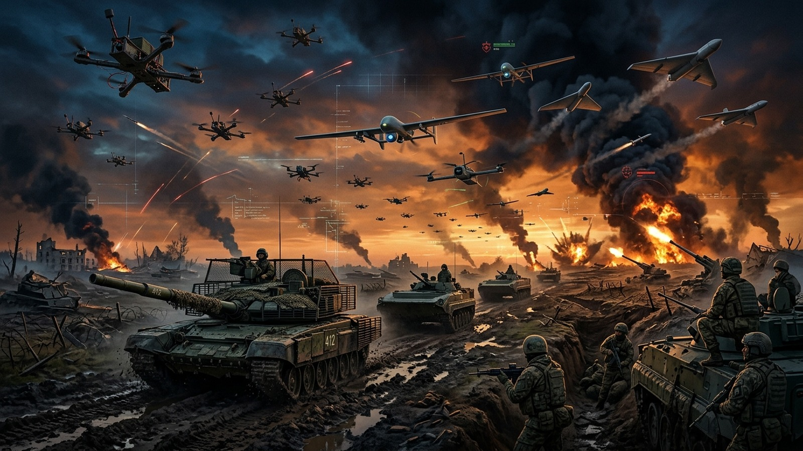
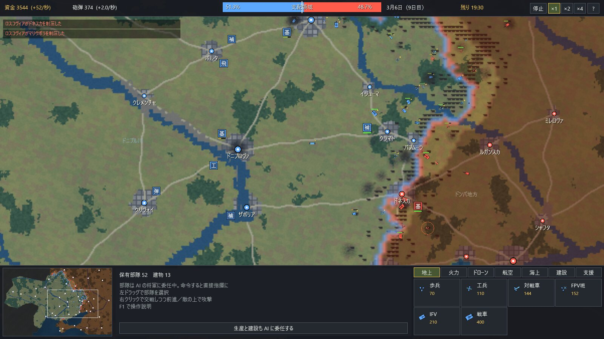

# ドローン戦線

ドローン・戦車・塹壕から巡航ミサイルまで、現代の戦争を丸ごと詰め込んだリアルタイムストラテジーです。
ウクライナ戦争を下敷きにした**架空の戦争**を舞台にしており、国名・地名・兵器名はすべて少し変えた架空の名前です。

プレイ時間は **2時間固定**で、**時間切れの時点で支配領域が広い陣営の勝ち**です。





同じ Rust のゲーム本体を、Windows 版にはネイティブで、ブラウザ版には WebAssembly にコンパイルして組み込みます。ひとつのリポジトリで両方をビルドします。

## 遊ぶ・ビルドする

### Windows 版

```bash
cargo run --release -p yydrone-win
```

`target/release/yydrone.exe` が単体で動きます。

### ブラウザ版

```bash
bash build.sh
```

```bash
python tools/serve.py
```

http://localhost:8765/ を開きます。WebGL2 対応のブラウザが必要です。

### Cloudflare への公開

`dist/` は静的サイトで、素材は wasm に埋め込まれています。

- **Workers（静的アセット）**：`bash build.sh && npx wrangler deploy`（設定は `wrangler.toml`）
- **Pages／Workers Builds（Git 連携）**：ビルドコマンド `npm run build`（中身は `bash build.sh`）、出力ディレクトリ `dist`。ビルド時に Rust を自動で導入します

### テスト

```bash
cargo test --release -p yydrone-core
```

`SIM_SEEDS=8 cargo test --release -p yydrone-core long_sim -- --nocapture` で AI 同士の対戦を複数回まわし、勝敗と領土の推移を確認できます。

## 構成

| 場所 | 内容 |
|---|---|
| `crates/core` | シミュレーション本体（地図・部隊・戦闘・領土・補給・経済・AI・史実の年表）。描画にも OS にも依存しない |
| `crates/game` | 画面・操作・描画（`Gfx` トレイト越しに両版で共有）。タッチ向けの画面は `mobile.rs` |
| `crates/web` | ブラウザ版の入口。`Gfx` を JavaScript 経由の WebGL2 / Canvas2D で実装 |
| `web/` | ブラウザ側の HTML と JavaScript |
| `crates/win` | Windows 版の入口。`Gfx` を Direct3D11 / DirectWrite で実装 |
| `build.sh` | wasm をビルドして `dist/` に静的サイトを出力 |

外部クレートは Windows 版の `windows` 系だけで、ブラウザ版は依存なしです。ユニット・建物・タイトル画像は高速なピクセル素材としてバイナリに組み込み、Direct3D11 / WebGL2 で描画しています。シミュレーションは固定ステップで、乱数の種が同じなら同じ展開になります。

## ゲームの内容

- **チュートリアル**：タイトルの「チュートリアル」から、選択・移動・制圧・戦闘・生産・建設・偵察・FPV・司令部の使い方を13課題で練習できます。両陣営に対応し、課題ごとのやり直し・スキップも可能。通常戦のセーブは変更しません（[詳細](docs/tutorial.md)）。
- **舞台**：ウクラヴィア共和国とロスコヴィア連邦の戦争。320×200 タイルの戦域に、海岸線・河川・43 の都市・道路・橋があります。開戦時の領土はほぼ互角です。
- **史実の年表**：2022年2月24日の全面侵攻から、キエヴァ前面での停止、ハルキア反攻、カホヴァ・ダム決壊、クルスカ越境、2026年10月のスターリンカ接続制限まで、実際の出来事 42 件が日付どおりに起こり、戦況を動かします（`F2` で年表。出典は [docs/timeline.md](docs/timeline.md)）。
- **領土**：歩兵や車両が進むと周囲の土地を占領します。市街地は時間がかかり、包囲された無人の飛び地は降伏します。
- **委任**：全部隊は最初 AI の将軍に任されています。命令した部隊だけ直接指揮に変わり、`Z` でまた委任できます。
- **将軍の提案と担当地域**：両陣営の9人の将軍は、担当領域と初期部隊を配属した状態で開始します。特性と戦況に応じて希望予算・戦地を自ら提案し、司令部で承認・見送りができます。地図の肖像カードには戦況ゲージと増強要請の「！」を表示し、マークから提案を開けます（[詳細](docs/command-system.md)）。
- **指揮中は時が止まる**：自軍の部隊を選んでから命令を出すまでと、範囲選択のドラッグ中は時間が止まります。命令を出すか選択を解くと進みます。
- **視界**：見えない敵は撃てません。森・市街・塹壕に隠れた部隊は偵察ドローンでなければ見つけにくく、火砲は撃つと位置が露見します。
- **補給と鉄道**：補給所から遠い部隊は消耗します。砲弾は有限です。つながった線路の上では補給が弱まらずに届き、自国の線路上は部隊も速く動けます。線路は地点攻撃で切れますが、しばらくすると復旧します。
- **地形**：樹林帯・森・市街・湿地（ポレシア）・高地とボタ山・川があり、移動・視界・被害が変わります。
- **季節と天候**：泥濘期は道路の外がほとんど動けなくなり、凍結すると車両は走りやすくなるが塹壕は掘りにくくなります。葉のある時期は樹林帯が歩兵をドローンから隠し、霧・雨・雪はドローンの目と発射を奪います（詳しくは [docs/terrain.md](docs/terrain.md)）。
- **陣営差**：ウクラヴィアはドローン・対戦車・精密兵器に強く、ロスコヴィアは砲弾と火砲・戦車の物量に強く、艦隊を持ちます。
- **長期戦のつり合い**：領土を広げるほど占領が遅くなり、大軍ほど維持費がかかります。押されている側は収入が増え、本土防衛で粘り、国土の大半を失うと総動員とパルチザンで巻き返します。

### 兵器

| 区分 | 内容 |
|---|---|
| 地上 | 歩兵、工兵、対戦車班、FPV 班、歩兵戦闘車、主力戦車 |
| 火力 | 自走榴弾砲、高機動ロケット砲、沿岸対艦ミサイル、自走対空砲、地対空ミサイル、電子戦車 |
| ドローン | 偵察ドローン、爆撃ドローン、武装 UAV、長距離自爆機（FPV は FPV 班が飛ばす） |
| 航空 | 攻撃ヘリ、戦闘攻撃機 |
| 海上 | フリゲート（巡航ミサイル）、水上ドローン |
| 工事 | 塹壕、地雷原、竜の歯、浮橋（橋は砲撃で落とせる） |
| 建物 | 軍事基地、飛行場、ドローン工房、砲弾工場、補給所、軍港 |
| 支援 | 巡航ミサイル、衛星偵察、緊急動員 |

### 操作

| 操作 | 内容 |
|---|---|
| 左ドラッグ／左クリック | 選択（Shift で追加、ダブルクリックで画面内の同種を全部） |
| 右クリック | 交戦しつつ前進／敵の上で攻撃／建物を選んでいれば集結地点 |
| `Q` `G` `S` `H` `Z` | 移動のみ、地点攻撃、停止、固守、AI に委任 |
| `T` `M` `B` `P` | 工兵：塹壕、地雷、竜の歯、浮橋（ドラッグで線を引く） |
| `Ctrl+数字`／`数字` | 部隊を群に登録／呼び出し |
| 矢印キー・画面端・中ボタン | 地図の移動（ホイールで拡大縮小） |
| `Space`、`＋`／`－` | 一時停止、速度 |
| `F1`、`F2`、`F11`、`Ctrl+＋`／`－` | 説明、年表、全画面、文字の大きさ |

### スマートフォン・タブレット

ブラウザ版は指で操作する端末を自動で判定し、タッチ向けの画面（UI を約 1000×480 に詰めて文字を大きくし、パネルは必要なときだけ地図に重ねる）に切り替えます。縦持ちでは横向きを促します。ホーム画面に追加すれば全画面のアプリとして使えます（PWA）。

| 操作 | 内容 |
|---|---|
| タップ | 選択。部隊を選んでいれば、そこへ命令（敵の上なら攻撃） |
| 長押ししてなぞる | 範囲選択 |
| なぞる | 地図の移動（一覧ではスクロール） |
| 2 本指 | 移動と拡大縮小 |
| 建物・支援の場所 | 1 回目のタップで確認、同じ場所をもう一度タップで確定 |
| 「生産」「画面内」ボタン | 生産パネルを開く／画面内の自軍を全部選ぶ |

`?touch=1`・`?compact=1` を URL に付けると、パソコンでもタッチ向けの画面を試せます。

## 記録（セーブ・ロード）

`F5` または画面の「記録」で開きます。手動の 3 枠と、2 分ごとの自動記録があります。タイトルの「続きから」で再開でき、再開直後は一時停止しています。

- **Windows 版**：`%LOCALAPPDATA%\yydrone` に保存します。閉じるときにも自動記録します。
- **ブラウザ版**：ブラウザの IndexedDB に保存します。画面が裏に回ったときにも自動記録します。別の端末へはファイル（`.yysav`）に書き出して移せます。

記録は 1 回 100KB 前後です。形式の版（`SAVE_VERSION`）が違う記録は読み込まずに知らせます。

## 参考

構成は `references/yyempire`（ブラウザ版）と `references/yyempire-win`（Windows 版）を参考にしました。スマートフォン・タブレット対応と記録の仕組みも yyempire から引き継いでいます。あちらは 2 つのリポジトリに分かれていますが、こちらは同じリポジトリの共通クレートにまとめています。


## ブラウザ版のキャッシュ更新

ゲーム内のヘルプ（F1）の「キャッシュを更新して再読み込み」で、セーブデータと設定を残したままゲームのキャッシュを更新して再読み込みできます。未保存の進行は戻らないため、必要なら先にF5の記録画面で保存してください。保存処理中は完了を待ち、保存失敗やメモリ上だけの記録がある場合は再読み込みを中止します。通信に失敗した場合も対局画面に留まります。 ゲームを読み込めなかったときは、エラー画面からも更新できます。

確認テスト：`node tools/test-browser-recovery.cjs`
